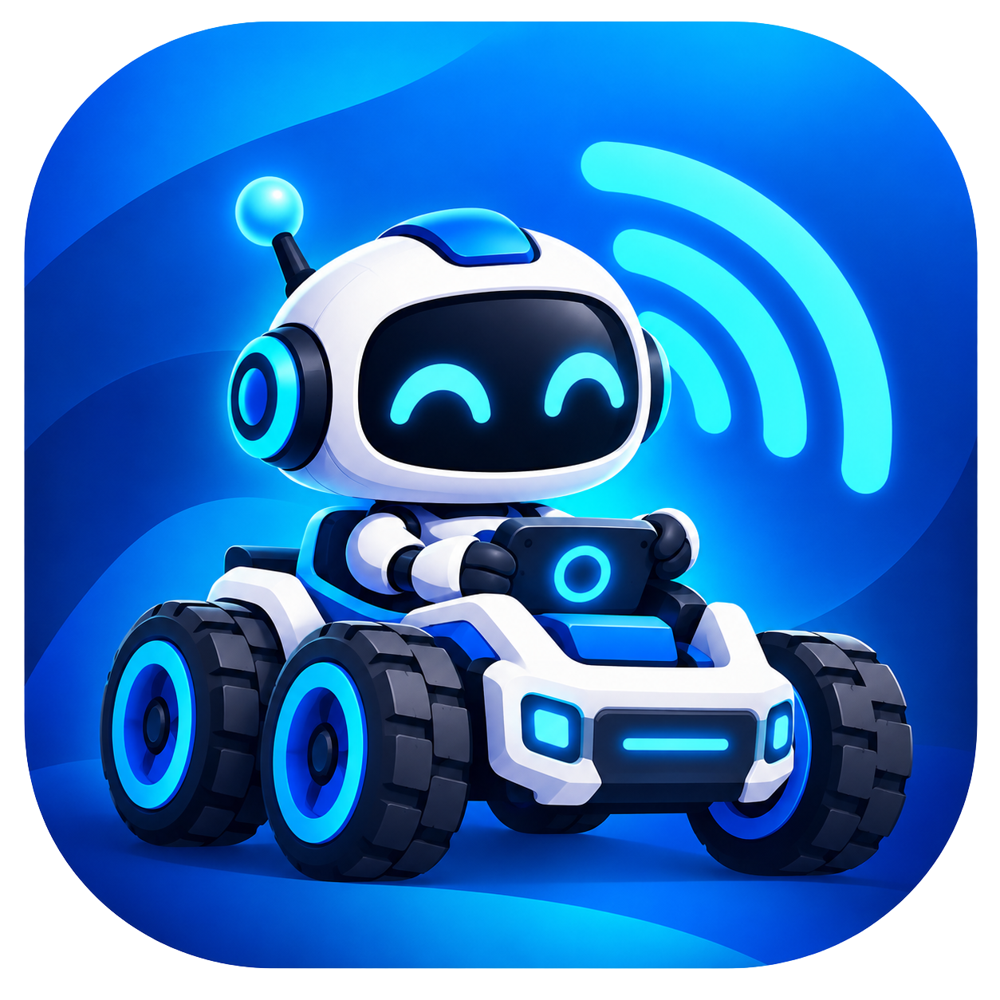

# Zin Robot (TSCINBUNY ZYC0109)



Phần mềm tự viết thay cho phần mềm gốc của xe robot **TSCINBUNY ZYC0109**: firmware STM32, firmware ESP32-CAM và app Android "Zin Robot". Điều khiển được bằng **điện thoại** hoặc **tay cầm PS5 (DualSense)**.

| Thư mục | Nội dung |
|---|---|
| [`firmware/`](firmware) | STM32F103 (Blue Pill): motor, bánh lái, servo camera, siêu âm, dò line, còi, LED RGB, các chế độ tự lái |
| [`esp32cam/`](esp32cam) | ESP32-CAM: Wi-Fi riêng + video, đèn flash, **tay cầm PS5 kết nối thẳng vào robot** |
| [`zin-app/`](zin-app) | App Android: lái, camera, chế độ, giọng nói, nhảy theo nhạc, bám màu/mặt, radar, **tay cầm PS5 qua điện thoại** |

## Phần cứng cần biết

- **Công tắc S3 (Bluetooth)** và **S4 (ESP32CAM)** trên bo mở rộng dùng chung một đường lệnh vào STM32. Chọn một trong hai cách điều khiển:

  | Cách điều khiển | S3 | S4 |
  |---|---|---|
  | App điện thoại (Bluetooth BT05), kể cả tay cầm ghép với điện thoại | **BẬT** | **TẮT** |
  | Tay cầm PS5 ghép thẳng vào robot | **TẮT** | **BẬT** |

  Bật cả hai cùng lúc thì lệnh từ app và từ tay cầm sẽ đè lên nhau.
- Chỉ có **2 kênh motor** (trái, phải) dù bo có 4 cổng.
- Camera phát Wi-Fi riêng: **ZinRobot-CAM**, mật khẩu `zinrobot2026`, địa chỉ `http://192.168.4.1/`.

## Điều khiển bằng app

1. Cài `ZinRobot.apk` (build bên dưới) và cấp quyền Bluetooth + Vị trí.
2. Bật robot (S3 bật, S4 tắt). App tự tìm robot "Zin Robot".
3. Muốn xem camera thì nối điện thoại vào Wi-Fi **ZinRobot-CAM**.

Có 3 kiểu lái: **Joystick**, **Hai bên** (như xe tăng), **Nghiêng** (nghiêng điện thoại). Có 5 chế độ: Lái tay, Tránh vật, Dò line, Bám theo, Canh gác. Nút **DỪNG** luôn đưa xe về tư thế nghỉ.

## Tay cầm PS5 (DualSense)

Có hai cách, phím bấm giống nhau.

### Cách A: ghép với điện thoại

Dùng khi muốn vừa lái bằng tay cầm vừa xem camera/radar trên app.

1. Giữ **Create** (nút nhỏ bên trái touchpad) + **PS** đến khi viền đèn nháy nhanh 2 nhịp.
2. Trên điện thoại: **Cài đặt → Bluetooth → Ghép thiết bị mới → DualSense Wireless Controller**.
3. Mở app: biểu tượng tay cầm màu tím hiện ở thanh trên cùng. Chạm vào để xem bảng phím.

Cần Android 12 trở lên để có rung và đổi màu thanh đèn.

### Cách B: ghép thẳng vào robot (không cần điện thoại)

1. Gạt **S3 tắt, S4 bật**, bật robot.
2. Tắt Bluetooth trên điện thoại hoặc PS5 đã ghép trước đó, để tay cầm không tự nối lại với máy cũ.
3. Giữ **Create + PS** đến khi đèn nháy nhanh. Robot tự dò và kết nối, tay cầm rung một cái.
4. Lần sau chỉ cần bấm **PS**.

Thanh đèn tay cầm cho biết trạng thái:
- **màu chế độ** (xanh dương = Lái tay…): đang điều khiển bình thường;
- **đỏ mờ**: STM32 không nhận được lệnh. Kiểm tra S4 bật, S3 tắt, cáp 4 chân ESP32-CAM đã cắm.

Trang kiểm tra (nối Wi-Fi ZinRobot-CAM):

| Địa chỉ | Tác dụng |
|---|---|
| `http://192.168.4.1/status` | Tay cầm, pin, kiểu lái, tốc độ, robot có trả lời không |
| `http://192.168.4.1/forget` | Quên các tay cầm đã ghép để ghép tay cầm khác |
| `http://192.168.4.1/config?tl=0&tr=0&st=0` | Cân chỉnh motor (app tự gửi khi bạn chỉnh trong Cài đặt) |

### Bảng phím

| Phím | Chức năng |
|---|---|
| **R2 / L2** | Tiến / lùi, bóp nhẹ = chậm |
| **Cần trái** | Đánh lái (đẩy lên/xuống cũng tiến/lùi) |
| **Cần phải** | Quay camera |
| **L3** | Đổi kiểu lái ô tô ↔ xe tăng (xe tăng: cần trái = bánh trái, cần phải = bánh phải) |
| **R3** | Camera nhìn thẳng |
| **✕** | Còi (giữ) |
| **○** | DỪNG, về tư thế nghỉ |
| **□ / △** | Đèn pha / đèn flash camera |
| **L1 / R1** | Xoay tại chỗ trái / phải |
| **D-pad ↑ ↓** | Tốc độ Chậm / Vừa / Nhanh |
| **D-pad ← →** | Quay camera từng nấc |
| **Options** | Chế độ kế tiếp |
| **Create** | Cách A: quét radar · Cách B: đèn cảnh sát 3 giây |

Tay cầm rung khi kết nối, khi xe tự phanh vì vật cản (lúc lái tay), khi bị kẹt và khi chế độ canh gác báo động.

**An toàn:** thả hết cần và cò thì xe dừng ngay. Tay cầm mất kết nối hoặc không gửi tín hiệu quá 0,4 giây thì xe dừng. STM32 tự dừng sau 600 ms không nhận lệnh.

## Build và nạp

Cần [PlatformIO](https://platformio.org/) (Windows: `%USERPROFILE%\.platformio\penv\Scripts\pio.exe`).

### STM32 (`firmware/`)

```
cd firmware
pio run
STM32_Programmer_CLI -c port=SWD -w .pio\build\bluepill\firmware.bin 0x08000000 -v -rst
```

Env `selftest` và `selftest_motors` dùng để thử phần cứng mà không cần Bluetooth.

### ESP32-CAM (`esp32cam/`)

Dùng **ESP-IDF 5.5** (khai báo sẵn trong `platformio.ini`), không phải Arduino. Lần build đầu tải khoảng 1 GB công cụ.

```
git submodule update --init          # tải BTstack (chỉ lần đầu)
cd esp32cam
pio run -t upload --upload-port COM8
```

- **Rút cáp 4 chân** nối ESP32-CAM với bo robot trước khi nạp, nếu không sẽ lỗi "serial TX path seems to be down".
- Trên Windows nên bật `git config core.longpaths true` trước khi tải submodule.
- Sửa `sdkconfig.defaults` xong thì xoá `sdkconfig.esp32cam` để cấu hình được tạo lại.
- Cổng UART0 dùng để nói chuyện với STM32 (9600 baud) nên ESP32 **không in log**. Xem trạng thái qua `/status`.

### App Android (`zin-app/`)

Build bằng công cụ SDK thuần (không dùng Gradle), cần Android SDK 35 và JDK của Android Studio:

```
powershell -File zin-app\build.ps1
adb install -r zin-app\ZinRobot.apk
```

## Giao thức lệnh

App và tay cầm (qua ESP32) gửi cùng một kiểu lệnh tới STM32, mỗi lệnh một dòng `#<chữ cái>[số,...]`. Ví dụ: `#D t,s` lái, `#M l,r` kiểu xe tăng, `#S` dừng, `#B 0|1` còi, `#A n` chế độ. Robot gửi lại trạng thái `#T ...` mỗi 200 ms. Danh sách đầy đủ ở [`firmware/src/modes.h`](firmware/src/modes.h).

## Thư viện bên ngoài

| Thư viện | Dùng cho | Giấy phép |
|---|---|---|
| [Bluepad32](https://github.com/ricardoquesada/bluepad32) (`esp32cam/components/bluepad32`, `cmd_nvs`, `cmd_system`) | Đọc tay cầm Bluetooth trên ESP32 | Apache-2.0 |
| [BTstack](https://github.com/bluekitchen/btstack) (`esp32cam/external/btstack`, submodule) | Bluetooth Classic trên ESP32 | Miễn phí cho dự án **phi thương mại**; dùng thương mại cần giấy phép của BlueKitchen |
| [esp32-camera](https://github.com/espressif/esp32-camera) (tải tự động) | Camera OV2640 | Apache-2.0 |
